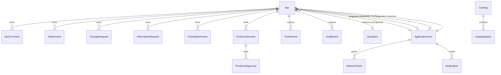

# Modelo de Dominio — Sistema de Gestión de NPIs

> Fase 0 — documentación de diseño, sin código todavía. Refleja las 11 decisiones confirmadas por el propietario el 2026-08-12 (ver `architecture-decisions.md` ADR-006 a ADR-016) sobre `docs/backend-analysis.md`.

## 1. Resumen de agregados

| Agregado / entidad raíz | Ciclo de vida | Motivo |
|---|---|---|
| **`Npi`** (agregado raíz) | Propio, complejo, con sub-entidades | Es el objeto central del negocio; todo lo que sólo tiene sentido *dentro* de un NPI concreto (comentarios, adjuntos, factibilidades, versiones de PrintCard, timers) vive dentro de su límite transaccional. |
| `ApplicationUser` | Independiente (Identity) | Los usuarios existen fuera de cualquier NPI concreto; un NPI sólo los referencia por Id. |
| `Quotation` | Independiente | Viene de "otra plataforma" (ver README); el NPI toma una foto de sus datos al crearse, no la posee. |
| `Catalog` / `CatalogOption` | Independiente | Administrado por el negocio, compartido por todos los NPIs. |
| `RefreshToken` | Independiente (Identity/Infra) | Ciclo de vida ligado a la sesión del usuario, no al NPI. |
| `Notification` | Independiente, pero escrita en la misma transacción que la acción que la origina | Es un efecto secundario auditado de una acción sobre un NPI; se consulta por usuario, no como parte del agregado `Npi`. |

## 2. Agregado raíz: `Npi`

### 2.1 Responsabilidad
Es la única puerta de escritura para: datos de captura del NPI, estado del ciclo de vida, estados por área, hitos del flujo, cronómetros y las colecciones satélite listadas en §3. Ninguna sub-entidad se modifica sin pasar por un método de `Npi` que valide invariantes.

### 2.2 Campos que **permanecen** en `Npi` (columnas simples, sin tabla propia)

| Grupo | Campos | Motivo |
|---|---|---|
| Identidad | `Id (Guid)`, `NpiNumber`, `RowVersion (rowversion)` | Claves de la entidad. |
| Captura (verde/amarillo/azul/naranja) | Los ~70 campos catalogados en `npiFields.ts` del frontend (cotización, dimensiones, película, elementos, empaque, complementarios) | Son atributos descriptivos del NPI, sin ciclo de vida, permisos ni versión propios — normalizarlos en tablas aparte sería fragmentación innecesaria (instrucción explícita del pedido). Los campos "azules" (catálogo) se guardan como `nvarchar` con el **valor** elegido (no FK a `CatalogOption.Id`): así un NPI histórico conserva el texto exacto aunque el catálogo cambie después; la pertenencia al catálogo se valida en la capa de Aplicación al escribir, no con una FK física. |
| Prioridad y snapshot de cotización | `Priority`, `QuotationId (FK nullable)`, `QuotationNumber` + columnas snapshot (cliente, tipo producto, anchos, calibres, etc.) | El snapshot es intencional: si la cotización cambia después, el NPI no debe mutar retroactivamente. `QuotationId` se conserva sólo para trazabilidad. |
| Ciclo de vida | `LifecycleStatus`, `TerminalReason` | Ver §4. |
| Estado por área | `EngineeringAreaStatus`, `DesignAreaStatus` | Ver §4.3 — reemplazan al enum global monolítico del frontend. |
| Auditoría de creación | `CreatedByUserId`, `CreatedAt`, `RequestDate` | — |
| Asignaciones | `AssignedEngineeringUserId`, `AssignedDesignUserId`, `AssignedCommercialUserId` | Referencian `ApplicationUser` por Id; no se embebe el usuario. |
| Cronómetros (4x, tipo valor embebido) | `GlobalTimer`, `CommercialTimer`, `EngineeringTimer`, `DesignTimer` (cada uno: `StartAt`, `EndAt`, `AccumulatedBusinessMs`, `RunningSinceAt`) | Mapeados como *owned types* de EF Core (columnas con prefijo, misma tabla `Npis`) — no ameritan tabla propia porque no se consultan ni autorizan independientemente del NPI; su **historial** de eventos sí (ver `TimerEvent`, §3). |
| Hitos del flujo (con fecha + actor) | `ArtesValidadasAt/ByUserId`; `PrintCardLoadedAt/ByUserId/VersionId`; `CodigoPT`, `PtName`, `PtRegisteredAt/ByUserId`; `PedidoSapNumber`, `PedidoSapRegisteredAt/ByUserId`; `EtCreatedAt/ByUserId`; `EtLoadedInSisproAt/ByUserId` | Escalares con fecha — no tienen colección propia ni versión; son "banderas con marca de tiempo". `EtCreatedAt` y `EtLoadedInSisproAt` son **hitos separados** (decisión 9), aunque el frontend actual los registre en el mismo clic. |
| Incidentes embebidos (grupos opcionales) | `SuppliesTemporaryRejection {At, ByUserId, Note}`; `SuppliesAgreement {Text, ResolvedAt, ResolvedByUserId, EvidenceAttachmentId}`; `ClientRejection {At, ByUserId, Comment, EvidenceAttachmentId}` | Cada uno ocurre **como mucho una vez** por NPI (no son historial repetible) — se guardan como grupos de columnas nulleables, no como tabla, para no fragmentar un hecho atómico único. Si el negocio pide más adelante permitir múltiples acuerdos de insumos, se promueven a tabla en ese momento. |

### 2.3 Elementos que **sí** tienen tabla independiente (con `NpiId` como FK)

| Entidad | Por qué tiene tabla propia |
|---|---|
| `NpiComment` | Colección abierta, con autor y fecha propios, consultable/paginable independientemente. |
| `Attachment` | Metadatos de archivo; **nunca** contenido binario/base64 en la fila del NPI (prohibido explícitamente). Ver §3.2 sobre su relación polimórfica con el resto de entidades. |
| `ChangeRequest` | Tiene su propio ciclo (creada, consultada en el historial), lista de campos afectados y adjuntos propios; tres orígenes distintos (Ingeniería→Comercial, Comercial→Diseño, y ahora "cliente reportado" vía `ChangeRequestOrigin`). |
| `InformationRequest` | Tiene estado propio (`Pending`/`Resolved`), dos tipos (`Client`/`Commercial`) y, en el tipo `Commercial`, una respuesta con su propio adjunto — más rico que un simple flag. |
| `FeasibilityReview` (una fila por área, máx. 2 por NPI) | Tiene aprobador, fecha, nota y adjuntos propios; independiente por diseño (decisión 1: Ingeniería y Diseño son evaluaciones paralelas sin relación de precedencia entre sí). |
| `PrintCardVersion` | Es una serie versionada (v1, v2, …) con archivo, código y autor propios. |
| `PrintCardApproval` | Tres aprobaciones (Diseño/Ingeniería/Cliente-vía-Comercial) **por versión** de PrintCard — normalizado con FK a `PrintCardVersionId` (el frontend las trataba como "la aprobación vigente" sin ligarlas formalmente a una versión; aquí se corrige). |
| `TimerEvent` | Bitácora *append-only* de cada `start/pause/resume/close/stage_change`, con duración acumulada al momento — se consulta y audita independientemente del estado actual del timer. |
| `AuditEvent` | Bitácora *append-only* de toda acción de negocio relevante (no sólo timers): quién, qué acción, cuándo, con qué resultado. Nunca se actualiza ni se borra. |

### 2.4 Relación de `Attachment` — actualizado en Fase 6 (implementación real, más simple que el diseño original)

**Diseño original (Fase 0)**: se planteó una FK inversa desde `Attachment` hacia su sub-entidad dueña (`CommentId`, `ChangeRequestId`, `FeasibilityReviewId`, etc.), listada en la tabla que existía antes en esta sección.

**Lo realmente implementado (Fase 6)**: un `Attachment` sólo pertenece a `(NpiId, Context, Version)` — sin FK inversa hacia una sub-entidad concreta. La vinculación a "qué evidencia qué" ocurre al revés, y sólo donde el flujo de negocio realmente lo necesita: la entidad dueña guarda el `Guid` del `Attachment` que la respalda:

| Dueño | Campo que referencia al Attachment |
|---|---|
| `PrintCardVersion` | `AttachmentId` (nulleable) |
| `PrintCardApproval` | `EvidenceAttachmentId` (nulleable; **obligatorio** cuando `Role = Client`) |
| `Npi.SuppliesAgreement` | `EvidenceAttachmentId` (obligatorio) |
| `Npi.ClientRejection` | `EvidenceAttachmentId` (nulleable) |

Para el resto de contextos (`Comment`, `ChangeRequest`, `Feasibility`, `InfoRequest`, `PtSap`) el `Attachment` sólo queda asociado al NPI y al `Context`/`Version` — no hay una FK que lo ligue a un comentario, factibilidad o solicitud de información concretos. Es una simplificación deliberada, documentada aquí en vez de dejarla como una divergencia silenciosa entre el diseño y el código: implementar las 5 FKs inversas restantes habría exigido ampliar `NpiComment`, `ChangeRequest`, `FeasibilityReview` e `InformationRequest` con colecciones de adjuntos propias — no había un caso de uso concreto que lo requiriera en las Fases 1-6, y el flujo de "subir adjunto → usar su `AttachmentId` en la siguiente acción" (`docs/api-contract.md` §7) ya cubre los cuatro casos donde el negocio sí exige evidencia formal.

`Version` en `Attachment` es un contador por `(NpiId, Context)`, igual que hoy en el frontend (`nextVersion`).

## 3. Value Objects (Dominio puro, sin EF/HTTP/Identity)

| VO | Campos | Comportamiento |
|---|---|---|
| `NpiNumber` | `string Value` (formato `NPI-####`) | Validación de formato; igualdad por valor. |
| `TimerState` | `StartAt?, EndAt?, AccumulatedBusinessMs, RunningSinceAt?` | `Start(IClock)`, `Pause(IClock, IBusinessCalendar)`, `Resume(IClock)`, `Close(IClock, IBusinessCalendar)`, `ElapsedMs(IClock, IBusinessCalendar)`. Nunca usa `DateTime.UtcNow` directamente — recibe `IClock`. El cálculo de tiempo transcurrido usa `IBusinessCalendar.BusinessMsBetween(a, b)` (L–V 09:00–18:00 América/Ciudad de México, festivos MX). |
| `Money`/`Priority` | `Priority` es un enum simple (`Low, Medium, High`) — no amerita VO propio, es un valor cerrado sin comportamiento. |

## 4. Ciclo de vida (`LifecycleStatus`) y estados por área

### 4.1 `LifecycleStatus` (alto nivel, decisión 10)

```
Draft ──submit──► Active ──(4 hitos completos)──► Completed
  │                  │
  │                  ├──(no factibilidad Ingeniería)────► Rejected [TerminalReason=NoFeasibility]
  │                  ├──(rechazo total por insumos)─────► Rejected [TerminalReason=SuppliesRejectionTotal]
  │                  └──(rechazo definitivo del cliente)► Rejected [TerminalReason=ClientRejection]
  │
  └──cancel (administrativo)──► Cancelled
                  (también alcanzable desde Active antes de llegar a un estado terminal)
```

`Completed`, `Rejected` y `Cancelled` son **terminales**: no se aceptan más comandos de transición de workflow (asignaciones, factibilidades, PrintCard, SAP, ET). Sí se sigue permitiendo **agregar comentarios** con fines de registro histórico (no cambia el estado).

### 4.2 Condición de éxito del ciclo (decisión 4)
`Active → Completed` cuando **las cuatro** condiciones son verdaderas simultáneamente:
1. `PrintCardLoadedAt != null`
2. `PtRegisteredAt != null` (con `CodigoPT` presente)
3. `PedidoSapRegisteredAt != null`
4. `EtLoadedInSisproAt != null`

Como `EtLoadedInSisproAt` sólo puede registrarse después de `EtCreatedAt` (decisión 9), y a su vez requiere `CodigoPT` + `PedidoSapNumber` (regla heredada del frontend), la acción `load-et-sispro` es en la práctica el "último dominó": si tiene éxito, dispara automáticamente la evaluación de las 4 condiciones y cierra el ciclo dentro de la misma transacción.

**Nota importante (decisión 3)**: `PrintCardLoadedAt` (acción "PrintCard cargado en Sistema") **no** es terminal ni completa el ciclo por sí sola — sólo cierra `DesignTimer`. El ciclo permanece `Active` hasta que también existan PT, Pedido SAP y ET en SisPro.

### 4.3 Estados por área (detalle operativo, no gatillan por sí solos las transiciones de `LifecycleStatus` — los hitos explícitos sí)

`EngineeringAreaStatus`: `Requested → Assigned → FeasibilityApproved → [SuppliesTemporaryRejection] → PtRegistered → EtCreated → EtLoadedInSispro` (más el terminal `NoFeasibility`, reflejo de `TerminalReason`).

`DesignAreaStatus`: `Requested → Assigned → FeasibilityApproved → ArtesValidadas → [AwaitingInformation] → PrintCardInApproval → PrintCardLoaded`.

Estos enums son **de presentación/consulta** (para paneles y filtros); las guardas de negocio de cada acción comprueban los hitos explícitos de `Npi` (§4.2), no el valor del enum de área, evitando el problema detectado en el frontend de reutilizar un mismo valor de estado para dos hitos distintos (`producto_en_sap` para PT y para ET).

## 5. Invariantes del agregado `Npi`

1. `NpiNumber` es único y se asigna atómicamente al pasar de `Draft` a `Active` (ver ADR de numeración en `architecture-decisions.md`).
2. Crear una `PrintCardVersion` requiere: `AssignedDesignUserId != null` **y** `FeasibilityReview[Engineering].Approved` **y** `FeasibilityReview[Design].Approved` **y** `ArtesValidadasAt != null` (decisión 2 — reemplaza la regla más laxa del frontend actual).
3. `FeasibilityReview[Engineering]` y `FeasibilityReview[Design]` no tienen precedencia entre sí — cualquiera puede aprobarse primero o en paralelo (decisión 1).
4. Cada nueva `PrintCardVersion` invalida (no borra) las `PrintCardApproval` de la versión anterior — las aprobaciones de una versión anterior no cuentan para la vigente.
5. `PrintCardApproval` de rol `Client` exige `EvidenceAttachmentId` obligatorio; los roles `Design`/`Engineering` no.
6. `DesignTimer` inicia únicamente cuando **ambas** condiciones se cumplen: `FeasibilityReview[Engineering].Approved` y `ArtesValidadasAt != null` (el que ocurra al último dispara el arranque).
7. `GlobalTimer.Close()` sólo se invoca desde dos lugares: la transición `Active → Completed` y la transición `Active → Rejected` (decisión 5). Ninguna otra acción cierra `GlobalTimer` directa o indirectamente (a diferencia del frontend, que lo cerraba en cascada cada vez que Ingeniería+Diseño quedaban cerrados).
8. `EtLoadedInSisproAt` requiere `EtCreatedAt != null` (decisión 9): son hitos separados y secuenciales, aun si una única acción de UI llegara a registrarlos juntos en el futuro.
9. `ClientRejection` requiere `Comment` obligatorio; `EvidenceAttachmentId` es opcional (decisión 7).
10. Una vez en estado terminal (`Completed`, `Rejected`, `Cancelled`) ningún comando de workflow muta `LifecycleStatus`, hitos, timers o asignaciones — es rechazado con conflicto (409), salvo `AddComment` (ver §4.1).
11. Toda transición que muta el agregado ocurre dentro de una única transacción de base de datos, incluyendo su(s) `AuditEvent`, `TimerEvent`(s) y `Notification`(s) asociados.
12. La numeración de NPIs semilla (`NPI-1000` en adelante) queda fuera del rango de la secuencia real (que arranca en 1), igual que hoy en el frontend.

## 6. Límites transaccionales

| Unidad de trabajo | Alcance |
|---|---|
| Cada acción de workflow (`submit`, `assign-*`, `*-feasibility`, `validate-artwork`, `printcards`, `printcard-approvals`, `register-*`, `load-*`, `reject-*`, `cancel`, etc.) | Una transacción: lee el agregado `Npi` completo (incluyendo colecciones satélite relevantes), aplica el cambio vía un método de dominio, persiste `Npi` + la(s) fila(s) satélite nuevas/actualizadas + `AuditEvent` + `TimerEvent`(s) + `Notification`(s) — todo o nada. Concurrencia optimista vía `RowVersion` (`rowversion` de SQL Server). |
| `AddComment`, `UploadAttachment` (contexto suelto) | Transacción propia, más simple (no cambia `LifecycleStatus` ni timers), pero igual genera su `AuditEvent`. |
| Consultas (`GET`) | Sin transacción explícita; siempre filtradas por autorización de recurso desde la base de datos (no post-filtrado en memoria). |
| `ApplicationUser`, `Quotation`, `Catalog/CatalogOption`, `RefreshToken` | Transacciones independientes de cualquier NPI — no se cargan ni bloquean como parte de la transacción de un `Npi`. |

## 7. Relaciones (resumen)



## 8. Entidades de ciclo de vida independiente

- **`ApplicationUser`** (extiende `IdentityUser<Guid>`): `FullName`, `Area (enum: Comercial|Ingenieria|Diseno|Total)`, `IsActive`. Los 7 roles funcionales se implementan como **roles nativos de ASP.NET Identity** (`AspNetRoles`/`AspNetUserRoles`), no como tabla de dominio propia — evita duplicar mecanismo. `Area` sí es una columna propia porque es una regla de negocio (no de autenticación) usada por las políticas de autorización.
- **`Quotation`**: `Id`, `QuotationNumber (unique)`, y los mismos campos "verdes" que hoy expone `data/quotations.ts`. Poblada por `IQuotationProvider` (implementación local por defecto).
- **`Catalog` / `CatalogOption`**: `Catalog(Id, Key unique, DisplayName)`; `CatalogOption(Id, CatalogId FK, Value, DisplayOrder, IsActive)`. Sustituye a `data/catalogs.ts` (19 catálogos).
- **`RefreshToken`**: `Id`, `UserId (FK)`, `TokenHash`, `ExpiresAt`, `CreatedAt`, `CreatedByIp`, `RevokedAt?`, `ReplacedByTokenId?`, `ReasonRevoked?`.
- **`Notification`**: `Id`, `RecipientUserId (FK)`, `NpiId (FK nullable)`, `Message`, `CreatedAt`, `ReadAt?`.

## 9. Enums de dominio (cerrados, sin tabla — gobiernan lógica, no son "listas de negocio")

`LifecycleStatus`, `TerminalReason`, `EngineeringAreaStatus`, `DesignAreaStatus`, `AreaType`, `Priority`, `AttachmentContext`, `TimerStage`, `TimerAction`, `InformationRequestType`, `InformationRequestStatus`, `ApproverRole`, `ChangeRequestOrigin (Internal | ClientReported)`.

Todo lo demás que sea una lista de opciones de negocio administrable (formato, acabado, mercado, tipo de material, etc. — los 19 catálogos del Excel "DATOS") es `CatalogOption`, no enum — pueden crecer sin desplegar código.
